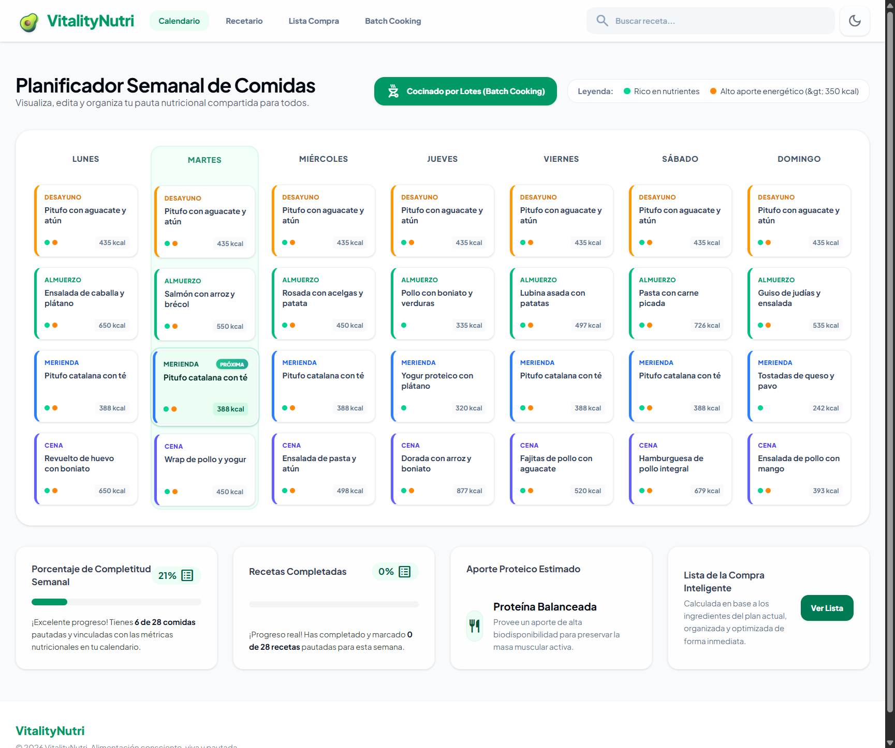
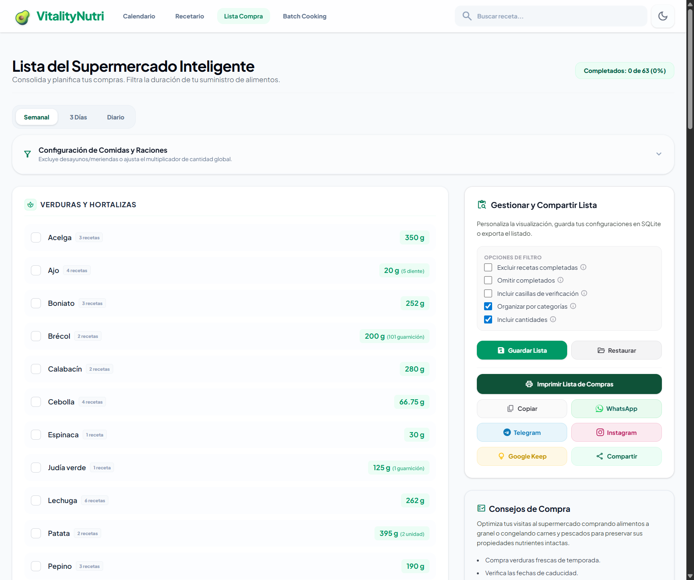
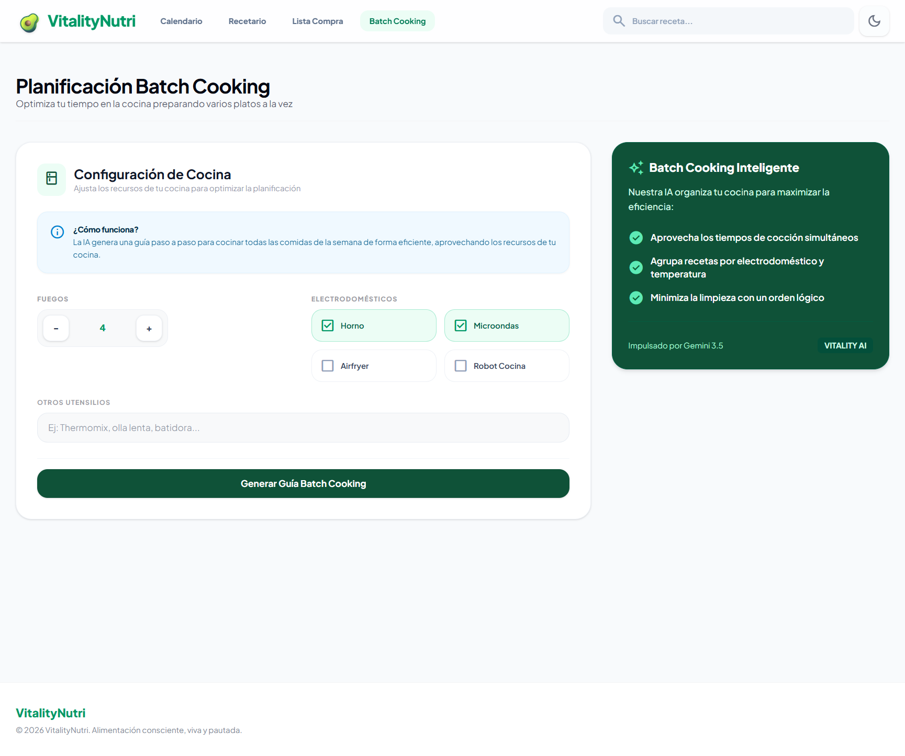

<div align="center">
  
  
  # 🥦 VitalityNutri 🥑
  ### Planificación de Alimentación Inteligente, Consciente y Saludable
  
  [](https://vite.dev/)
  [](https://react.dev/)
  [](https://tailwindcss.com/)
  []
  [](https://react.i18next.com/)
  [](https://www.typescriptlang.org/)
  [](https://sqlite.org/)
  [](https://www.docker.com/)
  
  **🌐 Español** · [English](README.md)
</div>

---

## 📝 Descripción

VitalityNutri es una aplicación web full-stack de planificación nutricional que automatiza la conversión de guías de alimentación en formato PDF a menús estructurados semanales mediante Inteligencia Artificial. Utiliza modelos de IA de última generación para extraer ingredientes, instrucciones y tablas calóricas con alta fidelidad. Toda la información se guarda en **SQLite**. Completamente internacionalizada con soporte para inglés y español.

---

## 📸 Capturas de Pantalla

<table>
  <tr>
    <td align="center"><br/><em>Calendario semanal — vista general del menú con acceso rápido a recetas y estado del batch cooking.</em></td>
    <td align="center"><br/><em>Lista de la compra inteligente agrupada por categorías del supermercado. Ajusta cantidades y marca productos.</em></td>
  </tr>
  <tr>
    <td align="center"><br/><em>Ficha completa de receta con ingredientes, instrucciones paso a paso e información nutricional.</em></td>
    <td align="center"><br/><em>Planificador de cocinado — qué preparar, cocinar y almacenar cada día.</em></td>
  </tr>
</table>

---

## ✨ Características

* **🤖 Extracción Automática con IA** — Carga planes PDF y la IA extrae menús semanales estructurados automáticamente
* **📅 Calendario Semanal Interactivo** — Visualización clara con 4 comidas diarias: Desayuno, Almuerzo, Merienda, Cena
* **🍲 Recetario y Ficha Detallada** — Ingredientes por plato, instrucciones paso a paso, calorías estimadas, imágenes Unsplash
* **🛒 Lista de Compras Inteligente** — Agrupada automáticamente por categorías, normalización inteligente, selección por día/rango, multiplicadores
* **📜 Historial de Planes y Restauración** — Navega entre planes anteriores, cámbialos, restáuralos o reprocésalos
* **🌐 Idioma Dual** — Interfaz completa en inglés y español con react-i18next
* **🥘 Guía de Batch Cooking** — Plan de cocinado optimizado generado por IA según tus electrodomésticos
* **📱 Compartir y Exportar** — Comparte recetas por WhatsApp, Telegram, correo o expórtalas a Keep Notes

---

## 🏗️ Arquitectura

```
vitalitynutri/
├── backend/                        # Solución .NET 10 Clean Architecture
│   ├── VitalityNutri.Api/
│   ├── VitalityNutri.Application/
│   ├── VitalityNutri.Domain/
│   ├── VitalityNutri.Infrastructure/
│   ├── VitalityNutri.Tests/
│   ├── prompts/
│   └── ...
├── frontend/                       # Workspace React/Vite
│   ├── src/
│   ├── public/
│   ├── e2e/
│   └── package.json
├── docker/                         # Imágenes independientes + Nginx
├── docs/
└── docker-compose.yml
```

---

## 🛠️ Tecnologías

### Frontend:
* **React 19** y **TypeScript**
* **Tailwind CSS v4** (con `@tailwindcss/vite`)
* **react-i18next** + **i18next** (internacionalización)
* **Motion** (animaciones)
* **Lucide React** y **Material Symbols** (iconos)

### Backend:
* **.NET 10** y controladores **ASP.NET Core**
* **Clean Architecture**, **MediatR**, **FluentValidation** y **AutoMapper**
* **Entity Framework Core 10** con **MySQL**
* **OpenAPI 3.1** nativo + **Scalar**

### DevOps:
* Imágenes Docker separadas para React/Nginx y ASP.NET Core
* **GitHub Actions** CI/CD (lint, build, deploy)
* **rimraf** (limpieza multiplataforma)

---

## 🚀 Instalación y Configuración Local

### Requisitos Previos:
*   [.NET 10 SDK](https://dotnet.microsoft.com/download/dotnet/10.0)
*   [Node.js](https://nodejs.org/) 22 o superior
*   Servidor MySQL
*   Docker Desktop para despliegue con contenedores

### 1. Clonar e instalar dependencias
```bash
cd vitalitynutri
npm --prefix frontend install
```

### 2. Configurar variables de entorno

Crea los archivos separados por nivel de confianza:

```powershell
Copy-Item .env.backend.example .env.backend
Copy-Item .env.frontend.example .env.frontend
```

- `.env.backend`: conexión MySQL, claves de proveedores AI y configuración privada.
- `.env.frontend`: configuración pública del navegador (por ahora, idioma inicial).

Consulta [Configuración y despliegue Docker](docs/CONFIGURATION.md) para la referencia completa.

### 3. Ejecutar en modo desarrollo

Inicia el backend .NET y el frontend Vite en terminales separadas:

```bash
dotnet run --project backend/VitalityNutri.Api/VitalityNutri.Api.csproj
npm --prefix frontend run dev
```

La aplicación estará disponible en: **http://localhost:5027**

---

## 🐳 Despliegue con Docker

Docker Compose crea dos imágenes independientes: React/Nginx para frontend y ASP.NET Core para backend. Nginx sirve la SPA y redirige `/api/*` al backend privado.

### Ejecutar:
```bash
docker compose config --quiet
docker compose up --build -d
```

### Comprobar:
```bash
docker compose ps
docker compose logs -f backend
docker compose logs -f frontend
```

> [!TIP]
> El frontend está disponible en `5027` y la API directamente en `5026`. Las llamadas `/api/*` del navegador siguen pasando por el proxy del frontend para evitar CORS. El backend conecta a tu MySQL mediante `host.docker.internal`.

### 📦 Personalizar el Tamaño Máximo de Subida de PDFs

Por defecto, el sistema admite planes PDF de hasta **15 MB**. Para personalizar este límite (por ejemplo, para planes de 30 MB):
1. En `.env.backend`: establece `ApiConfiguration__Upload__MaxFileSizeMb=30`.
2. En `.env.frontend`: establece `FRONTEND_MAX_UPLOAD_SIZE_MB=30` y `NGINX_CLIENT_MAX_BODY_SIZE=50M`.
3. Reinicia los contenedores: `docker compose up -d` (o `npm run docker:restart`).

---

## 📊 Diseño de la Base de Datos (Esquema SQLite)

El archivo de base de datos se guarda en `data/database.sqlite`.

### Tabla `plans`
Almacena los menús semanales extraídos y su estado:
*   `id`: Clave primaria autoincremental.
*   `file_name`: Nombre original del archivo PDF subido.
*   `saved_file_name`: Nombre único guardado en el servidor para evitar colisiones.
*   `plan_json`: JSON serializado con la estructura completa de días y comidas.
*   `metadata_json`: Metadatos del procesamiento.
*   `is_active`: Flag booleano (`1` o `0`) que identifica el plan actual en pantalla.
*   `created_at`: Fecha y hora de procesamiento.
*   `file_hash`: Hash SHA-256 para detección de duplicados.
*   `batch_cooking_json` / `batch_cooking_params`: Guía de batch cooking en caché.

### Tabla `grocery_list_state`
Persiste las interacciones del usuario con la lista de compra:
*   `id`: Clave primaria fija (`CHECK (id = 1)`) que asegura una sola fila de estado global.
*   `checked_items_json`: JSON con las casillas de verificación marcadas.
*   `list_type`: Tipo de vista (semanal, un día o tres días).
*   `selected_single_day` / `selected_3days_start`: Parámetros de filtrado temporal.
*   `excluded_meals_json`: Lista de comidas excluidas del cálculo de ingredientes.
*   `multipliers_json`: Escala de porciones para cada día de la semana.
*   `updated_at`: Última actualización.

### Tabla `completed_recipes_state`
Recetas marcadas como cocinadas en el plan activo:
*   `plan_id`: Clave foránea a `plans.id`.
*   `completed_json`: JSON que mapea identificadores de recetas a estados booleanos de completado.

### Tabla `recipes`
Recetario:
*   Campos estándar de receta (nombre, calorías, tiempo, etiqueta, imagen, ingredientes, pasos, consejos).
*   `source`: Origen (`manual`, `plan`, `ocr`, `text`, `document`).
*   `source_plan_id`: Referencia al plan de origen.
*   `is_ai_generated`, `is_favorite`: Flags booleanos.
*   `season`: Filtro de temporada (`Todas`, `Primavera`, `Verano`, `Otoño`, `Invierno`).

### Tabla `search_history`
Historial de clics en búsqueda de recetas (limitado a 10 entradas).

### Tabla `ingredients`
Diccionario de ingredientes conocidos con categorías para el agrupamiento inteligente de la lista de la compra.

---

## ⚙️ npm Scripts

| Script | Descripción |
|--------|-------------|
| `npm --prefix frontend run dev` | Inicia Vite con HMR en el puerto 5027 |
| `npm --prefix frontend run build` | Compila la aplicación React |
| `npm --prefix frontend run preview` | Previsualiza el frontend de producción |
| `npm --prefix frontend run lint` | Verificación de tipos TypeScript |
| `npm --prefix frontend test` | Ejecuta tests Vitest |
| `npm --prefix frontend run test:e2e` | Ejecuta tests E2E Playwright |
| `dotnet build backend/VitalityNutri.slnx` | Compila todos los proyectos backend |
| `dotnet test backend/VitalityNutri.slnx` | Ejecuta tests backend |

---

## 🤖 Pipeline CI/CD

El proyecto usa un único workflow de GitHub Actions (`.github/workflows/ci.yml`) con las siguientes etapas:

| Job | Descripción | Requiere secrets | Bloquea build |
|-----|-------------|-----------------|:---:|
| `lint` | TypeScript type-check | — | ✅ |
| `test` | Tests unitarios Vitest + coverage | — | ✅ |
| `codeql` | Análisis de seguridad CodeQL | — (solo en repo público) | ✅ |
| `snyk` | Escaneo de dependencias Snyk | `SNYK_TOKEN` | ✅ |
| `e2e` | Smoke tests con Playwright | — | ✅ |
| `sonar` | Quality gate SonarQube | `SONAR_TOKEN` | ✅ |
| `build` | Compilación frontend + backend | — | ✅ |
| `docker` | Build & push imagen a GHCR | — (usa `GITHUB_TOKEN`) | solo push |
| `deploy` | Despliegue por SSH al servidor | `SSH_HOST`, `SSH_KEY`, `DEPLOY_PATH` | solo push |

### 🔧 Forks / Autogestión

Los jobs que requieren servicios externos (`snyk`, `sonar`, `deploy`) se **saltan automáticamente** si sus secrets no están configurados. Para activarlos, añade estos **repository secrets** (`Settings → Secrets and variables → Actions`):

| Secret | Usado por | Propósito |
|--------|-----------|-----------|
| `SNYK_TOKEN` | `snyk` | Token API de Snyk para escaneo de dependencias |
| `SONAR_TOKEN` | `sonar` | Token de proyecto SonarQube |
| `SONAR_HOST_URL` | `sonar` | URL de tu servidor SonarQube (o usa `vars`) |
| `TAILSCALE_AUTHKEY` | `sonar`, `deploy` | Clave de Tailscale (opcional — saltar si el server es público) |
| `SSH_HOST` | `deploy` | Hostname del servidor de despliegue |
| `SSH_USER` | `deploy` | Usuario SSH |
| `SSH_KEY` | `deploy` | Clave privada SSH |
| `SSH_PORT` | `deploy` | Puerto SSH (por defecto: 22) |
| `DEPLOY_PATH` | `deploy` | Ruta en el servidor para el despliegue |

Para ejecutar el pipeline completo, haz el repositorio **público** (necesario para CodeQL code scanning en forks).
